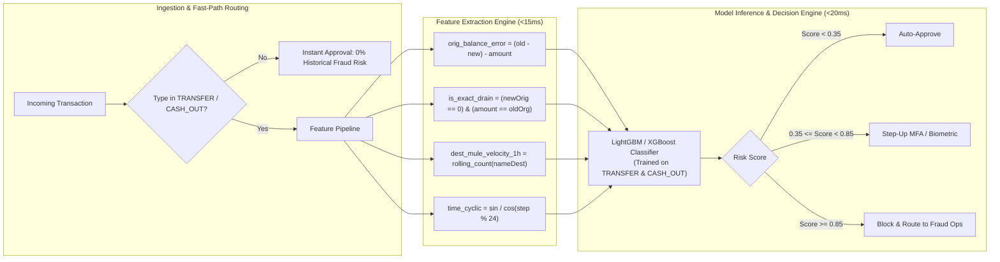

# Master Index: PaySim Financial Fraud Detection (`Jiraba.ipynb`)
**Senior Data Scientist & Machine Learning Engineering Knowledge Base**

---

## 1. Documentation & File Registry

| File Name | Location | Description |
| :--- | :--- | :--- |
| **`Jiraba.ipynb`** | [`D:\jiraba\Jiraba.ipynb`](file:///D:/jiraba/Jiraba.ipynb) | Master Jupyter Notebook containing 54 cells of exploratory data analysis and feature engineering. |
| **`Jiraba-checkpoint.ipynb`** | [`D:\jiraba\.ipynb_checkpoints\Jiraba-checkpoint.ipynb`](file:///D:/jiraba/.ipynb_checkpoints/Jiraba-checkpoint.ipynb) | Freshly synchronized Jupyter checkpoint. |
| **`JIRABA_NOTEBOOK_CODE_AND_EDA_DOCUMENTATION.md`** | [`D:\jiraba\JIRABA_NOTEBOOK_CODE_AND_EDA_DOCUMENTATION.md`](file:///D:/jiraba/JIRABA_NOTEBOOK_CODE_AND_EDA_DOCUMENTATION.md) | Exhaustive technical documentation covering every cell in depth with statistical and architectural critiques. |
| **`JIRABA_NOTEBOOK_CODE_AND_EDA_DOCUMENTATION.pdf`** | [`D:\jiraba\JIRABA_NOTEBOOK_CODE_AND_EDA_DOCUMENTATION.pdf`](file:///D:/jiraba/JIRABA_NOTEBOOK_CODE_AND_EDA_DOCUMENTATION.pdf) | High-fidelity publication-ready PDF export of the complete technical documentation. |
| **`INDEX.md`** | [`D:\jiraba\INDEX.md`](file:///D:/jiraba/INDEX.md) | This master navigation index, feature catalog, and formula reference guide. |

---

## 2. Granular Cell-by-Cell Master Navigation Index

| Cell # | Type | Exec # | Primary Function / Operation | Core Metric / Finding / Takeaway | Phase / Topic |
| :---: | :---: | :---: | :--- | :--- | :--- |
| **0** | Markdown | — | `### Shree 1\|` | Notebook section bookmark | Environment |
| **1** | Code | 1 | `import numpy, pandas, matplotlib, seaborn` | Loads core numerical & visualization stack | Environment |
| **2** | Code | 2 | `df = pd.read_csv(...)` | Ingests 6,362,620 rows $\times$ 11 columns (~600MB RAM) | Ingestion |
| **3** | Code | 3 | `df.head()` | Inspects top 5 rows; identifies merchant masking & fraud pairs | Inspection |
| **4** | Code | 4 | `df.isnull().sum()` | Confirms 0 nulls; highlights semantic missingness in 0.0 balances | Data Quality |
| **5** | Code | 5 | `df.columns` | Enumerates 11 features | Schema |
| **6** | Code | 6 | `df.dtypes` | 3 `int64`, 3 `object`, 5 `float64` machine types | Schema |
| **7** | Code | 7 | `df.describe()` | 8-number summary; flags power-law tail ($max = \$92.4\text{M}$) | Statistics |
| **8** | Code | 8 | `df.nunique()` | `nameOrig` 99.85% unique (ephemeral); `nameDest` reusable | Cardinality |
| **9** | Code | 9 | `df['type'].unique()` | 5 categories: PAYMENT, TRANSFER, CASH_OUT, DEBIT, CASH_IN | Categorical |
| **10** | Code | 10 | `df['isFraud'].value_counts()` | Class distribution: 6,354,407 (0) vs 8,213 (1) -> 773.7:1 ratio | Target |
| **11** | Code | 11 | `df['isFlaggedFraud'].value_counts()` | Rule alert: only 16 flagged across entire dataset | Benchmark |
| **12** | Code | 12 | `df.duplicated().sum()` | 0 duplicate rows found | Data Quality |
| **13** | Code | 13 | `sns.histplot(df['step'])` | 743 hourly steps (~31 days); reveals diurnal 24h cyclical waves | Temporal |
| **14** | Code | 14 | `sns.countplot(df['type'])` | Volume distribution: `CASH_OUT` and `PAYMENT` dominate | Categorical |
| **15** | Code | 15 | `sns.histplot(df['amount'])` | Visualizes extreme right skew on linear scale | Univariate |
| **16** | Code | 16 | `df['nameOrig'].value_counts().head(10)` | Senders are disposable (max transactions per ID is 2–3) | Entities |
| **17** | Code | 17 | `sns.boxplot(df['oldbalanceOrg'])` | Sender balance outliers up to $\$60\text{M}$ | Univariate |
| **18** | Code | 18 | `df['nameDest'].value_counts().head(10)` | Recipients cluster up to 115+ transactions (merchants/mules) | Entities |
| **19** | Code | 19 | `sns.boxplot(df['oldbalanceDest'])` | Recipient opening balance reaches $\$356\text{M}$ | Univariate |
| **20** | Code | 20 | `sns.boxplot(df['newbalanceDest'])` | Recipient closing balance reaches $\$356\text{M}$ | Univariate |
| **21** | Code | 21 | `sns.countplot(df['isFraud'])` | Linear visual representation of 0.129% target rarity | Target |
| **22** | Code | 22 | Duplicate rerun of Cell 18 | Top destination account frequencies | Redundant |
| **23** | Code | 23 | Duplicate rerun of Cell 19 | Recipient opening balance boxplot | Redundant |
| **24** | Code | 24 | Duplicate rerun of Cell 20 | Recipient closing balance boxplot | Redundant |
| **25** | Code | 25 | `sns.countplot(df['isFlaggedFraud'])` | Rule alert linear visualization (16 vs 6.36M) | Benchmark |
| **26** | Code | 26 | `sns.boxplot(x='isFraud', y='amount')` | Legit max ($92.4\text{M}$) exceeds fraud max ($10.0\text{M}$); fraud median higher | Bivariate |
| **27** | Code | 27 | `sns.countplot(x='type', hue='isFraud')` | Raw count visualization concealing rare fraud bars | Bivariate |
| **28** | Code | 28 | `sns.scatterplot('oldbalanceOrg', 'newbalanceOrig')` | Scatter overplotting; reveals $y=x$ and $y=0$ drain lines | Bivariate |
| **29** | Code | 29 | `df.groupby('step')['isFraud'].sum().plot()` | Shows steady persistent daily fraud attacks across 31 days | Temporal |
| **30** | Code | 30 | `sns.heatmap(df.corr(), annot=True)` | Multicollinearity ($r\approx1.0$); zero linear correlation with target | Association |
| **31** | Code | 31 | Formatted string printout | 6,354,407 legitimate vs 8,213 fraudulent counts | Reporting |
| **32** | Code | 32 | Normalized proportions | **99.8709% Legitimate** vs **0.1291% Fraudulent** | Reporting |
| **33** | Code | 33 | Styled publication count plot | Custom palette (`steelblue` vs `tomato`) with clear annotations | Visuals |
| **34** | Code | 35 | Strategic `groupby('type')` table | **100% of fraud is in TRANSFER (4,097) & CASH_OUT (4,116)** | **Discovery** |
| **35** | Code | 36 | Bar plot of `fraud_rate_pct` by type | TRANSFER rate is 0.7688% ($4.18\times$ higher than CASH_OUT 0.1840%) | Visuals |
| **36** | Code | 37 | Grouped bar plot: type vs count by class | Volume context with class breakdown | Visuals |
| **37** | Code | 38 | `groupby('isFraud')['amount'].agg(...)` | Fraud mean $\$1.47\text{M}$ ($8.2\times$ legit); fraud median $\$441.4\text{K}$ ($5.9\times$ legit) | Statistics |
| **38** | Code | 40 | Boxplot with `showfliers=False` & log scale | Fraud IQR shifted upward by over an order of magnitude | Visuals |
| **39** | Code | 41 | **Balance Discrepancy Feature Engineering** | Computes $\text{orig\_balance\_error}$ and $\text{dest\_balance\_error}$ | **Engineering** |
| **40** | Code | 42 | Median balance feature summary table | Fraud median $\text{orig\_balance\_error} = \mathbf{0.00}$ (Legit $= -\$69\text{K}$) | **Discovery** |
| **41** | Code | 43 | Subsampled ($N=30,000$) symlog scatter | Shows fraud points clustering strictly on $y=0$ complete-drain line | Visuals |
| **42** | Code | 44 | Mismatch thresholding (`tol = 0.01`) | **Legit sender mismatch is 79.73%; Fraud mismatch is ONLY 0.548%** | **Discovery** |
| **43** | Code | 46 | Bar plot of mismatch rates | Visualizes the 80% vs 0.5% sender accounting discrepancy | Visuals |
| **44** | Code | 47 | Temporal hourly aggregation table | Evaluates hourly volume and fraud rates | Temporal |
| **45** | Code | 48 | Line plot of fraud count over time | Confirms continuous threat presence across simulation | Temporal |
| **46** | Code | 50 | Line plot of fraud rate % over time | Uncovers simulation artifact: legit drops after step 390 | **Diagnostics** |
| **47** | Code | 51 | Crosstab: `isFraud` vs `isFlaggedFraud` | Matrix: $TP=16, FP=0, FN=8,197, TN=6,354,407$ | Benchmark |
| **48** | Code | 52 | Precision & Recall calculation | **Precision = 1.0000 (100%), Recall = 0.0019 (0.19%)** | Benchmark |
| **49** | Code | 53 | Executive KPI Summary Console Report | Unified text reporting dashboard | Reporting |
| **50** | Code | 54 | `orig_balance_error` distribution table | Fraud error max is $0.00$, median is $0.00$; legit mean is $-\$201\text{K}$ | Forensics |
| **51** | Code | 55 | Pivot table: mismatch rate by type $\times$ class | TRANSFER legit mismatch: 96.2% vs fraud: 0.51% | Forensics |
| **52** | Code | 56 | Granular inspection of 20 fraud records | Forensically confirms paired TRANSFER $\to$ CASH_OUT attack pattern | Forensics |
| **53** | Code | — | Trailing blank code cell | Unexecuted empty cell | Cleanup |

---

## 3. Data Dictionary & Feature Engineering Catalog

### A. Raw Features

| Feature Name | Storage Type | Domain Interpretation | Distribution / Cardinality |
| :--- | :--- | :--- | :--- |
| **`step`** | `int64` | Time unit of simulation ($1\text{ step} = 1\text{ hour}$). | $1 \le step \le 743$ ($\approx 31$ days). Diurnal cyclic pattern. |
| **`type`** | `object` (string) | Channel/method of transaction. | 5 categories: `PAYMENT`, `TRANSFER`, `CASH_OUT`, `DEBIT`, `CASH_IN`. |
| **`amount`** | `float64` | Transaction monetary value in local currency. | Range: $0.00$ to $\$92,445,516.64$. Highly right-skewed. |
| **`nameOrig`** | `object` (string) | Unique ID of originating customer account (`C...`). | $6,353,307$ unique values ($99.85\%$ unique). Single-use senders. |
| **`oldbalanceOrg`** | `float64` | Sender balance before the transaction occurred. | Median: $\$14,208.00$; Max: $\$59,585,040.00$. Zero-inflated. |
| **`newbalanceOrig`** | `float64` | Sender balance after the transaction completed. | Median: $\$0.00$; Max: $\$49,585,040.00$. Zero-inflated. |
| **`nameDest`** | `object` (string) | Recipient ID. `'M'` = Merchant, `'C'` = Customer. | $2,722,362$ unique values ($42.8\%$ unique). Shows clustering. |
| **`oldbalanceDest`** | `float64` | Recipient opening balance before transaction. | Median: $\$132,705.70$; Max: $\$356,015,900.00$. Masked for merchants. |
| **`newbalanceDest`** | `float64` | Recipient closing balance after transaction. | Median: $\$214,661.40$; Max: $\$356,179,300.00$. Masked for merchants. |
| **`isFraud`** | `int64` | **Ground Truth Target.** $1 =$ Fraud, $0 =$ Legit. | $8,213$ frauds ($0.1291\%$), $6,354,407$ legit ($99.8709\%$). |
| **`isFlaggedFraud`** | `int64` | Legacy system rule alert ($amount > 200,000$). | $16$ alerts triggered. Recall $= 0.19\%$. |

### B. Engineered Features (Introduced in Notebook)

| Feature Name | Mathematical Definition | Domain & Machine Learning Value |
| :--- | :--- | :--- |
| **`orig_balance_change`** | $\text{oldbalanceOrg} - \text{newbalanceOrig}$ | Gross funds deducted from the sender account. |
| **`dest_balance_change`** | $\text{newbalanceDest} - \text{oldbalanceDest}$ | Gross funds credited to the recipient account. |
| **`orig_balance_error`** | $(\text{oldbalanceOrg} - \text{newbalanceOrig}) - \text{amount}$ | **Super-Feature:** Measures accounting violation on sender. In 99.45% of fraud, error is strictly $0.00$. |
| **`dest_balance_error`** | $(\text{newbalanceDest} - \text{oldbalanceDest}) - \text{amount}$ | Measures accounting violation on recipient account. |
| **`orig_balance_mismatch`** | $\|\text{orig\_balance\_error}\| > 0.01$ | Binary flag indicating sender balance math deviation. True in 79.73% legit vs 0.55% fraud. |
| **`dest_balance_mismatch`** | $\|\text{dest\_balance\_error}\| > 0.01$ | Binary flag indicating recipient balance math deviation. |

---

## 4. Mathematical Formula Reference

### 1. Class Imbalance Ratio
$$\text{Imbalance Ratio} = \frac{N_{\text{legitimate}}}{N_{\text{fraud}}} = \frac{6,354,407}{8,213} \approx 773.7 : 1$$

### 2. Sender Double-Entry Accounting Invariant
$$\text{Error}_{\text{orig}} = (\text{oldbalanceOrg} - \text{newbalanceOrig}) - \text{amount}$$
$$\text{orig\_balance\_mismatch} = \begin{cases} 1 & \text{if } |\text{Error}_{\text{orig}}| > \epsilon \\ 0 & \text{if } |\text{Error}_{\text{orig}}| \le \epsilon \end{cases} \quad (\text{where } \epsilon = 0.01)$$

### 3. Rule Engine Performance Metrics
$$\text{Precision} = \frac{TP}{TP + FP} = \frac{16}{16 + 0} = 1.0000 \quad (100.0\%)$$
$$\text{Recall} = \frac{TP}{TP + FN} = \frac{16}{16 + 8,197} = \frac{16}{8,213} \approx 0.001948 \quad (0.19\%)$$
$$F_1 = 2 \cdot \frac{\text{Precision} \cdot \text{Recall}}{\text{Precision} + \text{Recall}} \approx 0.003889$$

### 4. Cyclical Diurnal Time Encoding
$$\text{hour} = \text{step} \pmod{24}$$
$$x_{\sin} = \sin\left(\frac{2\pi \cdot \text{hour}}{24}\right), \quad x_{\cos} = \cos\left(\frac{2\pi \cdot \text{hour}}{24}\right)$$

---

## 5. Production Machine Learning Architecture Blueprint

