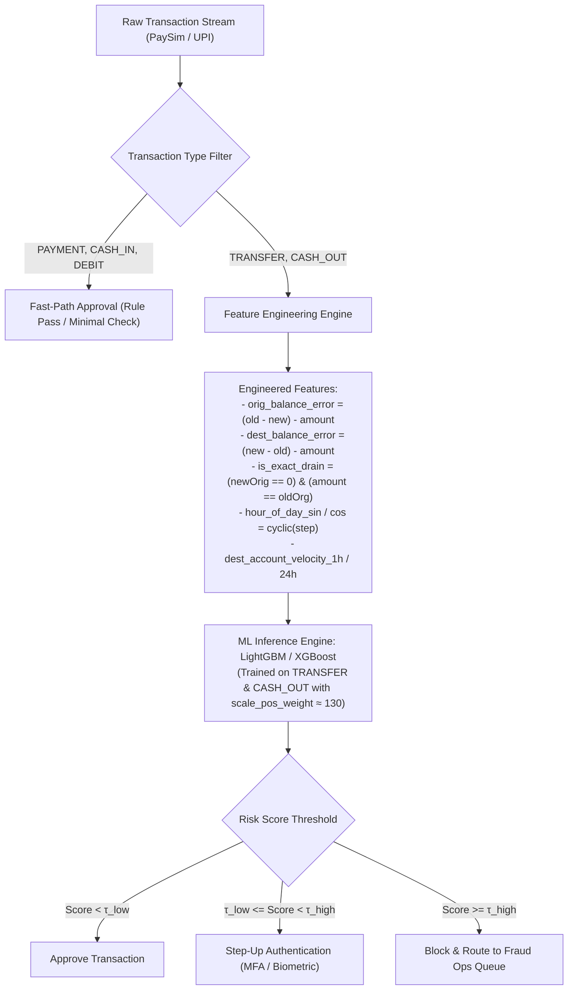

# PaySim Mobile Money / UPI Fraud Detection: In-Depth Technical Documentation
## Comprehensive Cell-by-Cell Data Science & Machine Learning Engineering Analysis of `Jiraba.ipynb`

---

### Executive Architectural & Domain Overview

This document provides a senior-level data scientist and machine learning engineer walkthrough of the Jupyter Notebook `Jiraba.ipynb`.

#### 1. The Dataset: PaySim Synthetic Financial Simulator
The dataset loaded in this notebook (`paysim1/PS_20174392719_1491204439457_log.csv`) originates from **PaySim**, an agent-based financial simulator modeled on actual transactional logs from a mobile money service operated in an African country (originally published by Lopez-Rojas et al.).
- **Total volume:** $6,362,620$ transactions.
- **Simulation Duration:** 743 discrete time steps (where $1\text{ step} = 1\text{ hour}$, spanning $\approx 31$ days).
- **Core Business Goal:** Detect unauthorized account takeover and fraudulent transfers/cashouts under severe class imbalance ($0.1291\%$ fraud prevalence).

#### 2. The Anatomy of Fraud in the System
The exploratory analysis uncovers the primary fraudulent modus operandi:
1. **Compromise / Account Takeover:** Fraudsters gain access to a customer account (`nameOrig`).
2. **Account Liquidation via `TRANSFER`:** The fraudster initiates a `TRANSFER` of the **entire balance** (`amount == oldbalanceOrg`, reducing `newbalanceOrig` to `0.00`).
3. **Immediate Liquidation via `CASH_OUT`:** The funds received at a drop account (`nameDest`) are immediately converted to physical cash via a `CASH_OUT` transaction of the exact same amount.
4. **Complete Absence in Other Types:** Fraud occurs **exclusively** in `TRANSFER` ($4,097$ cases) and `CASH_OUT` ($4,116$ cases). Transactions of type `PAYMENT`, `CASH_IN`, and `DEBIT` contain **zero** instances of fraud in this entire $6.36$-million-row dataset.

#### 3. Naive Rule-Based Alert System Failure (`isFlaggedFraud`)
The legacy business rule flags transactions where `amount > 200,000` in a single transfer. Out of $8,213$ actual frauds, the rule flags only **$16$ transactions** ($0.19\%$ Recall). While its Precision is $100\%$ ($0$ False Positives), its inability to detect $99.81\%$ of attacks renders it ineffective in production without ML intervention.

---

### In-Depth Cell-by-Cell Breakdown (Cell 0 through Cell 53)

```
Notebook Structure:
Total Cells: 54
Markdown Cells: 1 (Cell 0)
Code Cells: 53 (Cells 1 - 53)
Executed Code Cells: Cells 1 - 52
Unexecuted Code Cells: Cell 53
```

---

#### Cell 0: Header Bookmark
- **Cell Type:** Markdown
- **Execution Count:** None
- **Source Code:**
  ```markdown
  ### Shree 1|
  ```
- **Output:** [No output rendered]
- **Senior DS / MLE Explanation:**
  - Traditional invocation or project section marker used by the author to label the initiation of Phase 1 of the exploratory notebook.

---

#### Cell 1: Environment & Core Scientific Library Imports
- **Cell Type:** Code
- **Execution Count:** 1
- **Source Code:**
  ```python
  import numpy as np
  import pandas as pd
  import matplotlib.pyplot as plt
  import seaborn as sns
  ```
- **Output:** [No output]
- **Senior DS / MLE Explanation:**
  - **`numpy` (Numerical Python):** Provides vectorized array primitives, linear algebra routines, and memory-contiguous C-buffers.
  - **`pandas`:** Primary DataFrame library for structured tabular data manipulation, columnar aggregations, and I/O.
  - **`matplotlib.pyplot`:** Low-level, object-oriented charting backend providing canvas rendering control, scaling, and formatting.
  - **`seaborn`:** High-level statistical visualization layer built atop Matplotlib, facilitating split-apply-combine chart rendering (`hue`, `col`, etc.).
  - **Senior MLE Critique & Best Practice:**
    - For large tabular data ($>6\text{M}$ rows), memory footprint should be planned early. It is best practice to also set plotting defaults here:
      ```python
      %matplotlib inline
      pd.set_option('display.max_columns', None)
      pd.set_option('display.float_format', lambda x: f'{x:.4f}')
      ```

---

#### Cell 2: Data Ingestion from Local Disk
- **Cell Type:** Code
- **Execution Count:** 2
- **Source Code:**
  ```python
  df = pd.read_csv("paysim1/PS_20174392719_1491204439457_log.csv")
  ```
- **Output:** [No output]
- **Senior DS / MLE Explanation:**
  - Ingests the 6.36 million row CSV file into memory as a Pandas DataFrame.
  - **Memory Footprint Analysis:**
    - By default, Pandas reads integer columns as `int64` ($8$ bytes per element) and floating points as `float64` ($8$ bytes). Categorical object strings (`type`, `nameOrig`, `nameDest`) are allocated as Python string pointers.
    - Initial in-memory footprint is approximately $\approx 530\text{ MB} - 650\text{ MB}$.
  - **Senior MLE Critique & Optimization:**
    - In production pipelines or lower-RAM instances, reading this raw table without explicit schema definitions risks Out-Of-Memory (OOM) errors during copy operations.
    - Specifying `dtype` downcasting can reduce RAM usage by up to $60\%$:
      ```python
      dtypes = {
          'step': 'int16',
          'type': 'category',
          'amount': 'float32',
          'oldbalanceOrg': 'float32',
          'newbalanceOrig': 'float32',
          'oldbalanceDest': 'float32',
          'newbalanceDest': 'float32',
          'isFraud': 'int8',
          'isFlaggedFraud': 'int8'
      }
      ```

---

#### Cell 3: Initial Tabular Data Sampling (`head`)
- **Cell Type:** Code
- **Execution Count:** 3
- **Source Code:**
  ```python
  df.head()
  ```
- **Output:** Displays the first 5 records (indices 0 to 4).
  - Row 0: `step=1, type=PAYMENT, amount=9839.64, oldbalanceOrg=170136.0, newbalanceOrig=160296.36, isFraud=0`
  - Row 2: `step=1, type=TRANSFER, amount=181.00, oldbalanceOrg=181.0, newbalanceOrig=0.00, isFraud=1`
  - Row 3: `step=1, type=CASH_OUT, amount=181.00, oldbalanceOrg=181.0, newbalanceOrig=0.00, isFraud=1`
- **Senior DS / MLE Explanation:**
  - Provides immediate verification of column alignment and data integrity.
  - **Domain Pattern Spotted Immediately:**
    - Look at Rows 2 & 3: Both have `amount = 181.00`, `oldbalanceOrg = 181.00`, and `newbalanceOrig = 0.00`. Both have `isFraud = 1`.
    - Row 2 is a `TRANSFER` from `C1305486145` to `C553264065`.
    - Row 3 is a `CASH_OUT` from `C840083671` to `C38997010`.
    - Notice that customer accounts begin with `'C'` and merchant accounts begin with `'M'`. Notice that for Merchant destinations (Rows 0, 1, 4), `oldbalanceDest` and `newbalanceDest` are both `0.0`. This reveals that merchant balance tracking is masked or zeroed in PaySim!

---

#### Cell 4: Missing Value Auditing (`isnull().sum()`)
- **Cell Type:** Code
- **Execution Count:** 4
- **Source Code:**
  ```python
  df.isnull().sum()
  ```
- **Output:**
  ```text
  step              0
  type              0
  amount            0
  nameOrig          0
  oldbalanceOrg     0
  newbalanceOrig    0
  nameDest          0
  oldbalanceDest    0
  newbalanceDest    0
  isFraud           0
  isFlaggedFraud    0
  dtype: int64
  ```
- **Senior DS / MLE Explanation:**
  - Iterates column by column, evaluating nullity predicates and aggregating boolean counts.
  - **Result:** $0$ missing values across all $11$ features.
  - **Senior MLE Alert:** While there are no IEEE `NaN` / `None` values, **semantic missingness** exists. Many balance values are recorded as `0.0` when they are actually unknown or withheld (e.g., merchant destination balances `oldbalanceDest == 0.0` and `newbalanceDest == 0.0`). A senior engineer must treat these structural zeros distinctly from legitimate zero balances.

---

#### Cell 5: Schema Attribute Enumeration (`df.columns`)
- **Cell Type:** Code
- **Execution Count:** 5
- **Source Code:**
  ```python
  df.columns
  ```
- **Output:**
  ```text
  Index(['step', 'type', 'amount', 'nameOrig', 'oldbalanceOrg', 'newbalanceOrig',
         'nameDest', 'oldbalanceDest', 'newbalanceDest', 'isFraud',
         'isFlaggedFraud'],
        dtype='object')
  ```
- **Senior DS / MLE Explanation:**
  - Inspects the exact names and indexation of features.
  - Identifies target label candidate (`isFraud`), benchmark rule candidate (`isFlaggedFraud`), temporal index (`step`), categorical features (`type`, `nameOrig`, `nameDest`), and continuous balance/monetary features.

---

#### Cell 6: Data Type Verification (`df.dtypes`)
- **Cell Type:** Code
- **Execution Count:** 6
- **Source Code:**
  ```python
  df.dtypes
  ```
- **Output:**
  ```text
  step                int64
  type               object
  amount            float64
  nameOrig           object
  oldbalanceOrg     float64
  newbalanceOrig    float64
  nameDest           object
  oldbalanceDest    float64
  newbalanceDest    float64
  isFraud             int64
  isFlaggedFraud      int64
  dtype: object
  ```
- **Senior DS / MLE Explanation:**
  - Confirms machine representations.
  - Notice `type`, `nameOrig`, `nameDest` are `object` (strings). If passed directly into gradient boosting trees or linear models, they will throw runtime errors without encoding or tokenization.

---

#### Cell 7: Parametric & Non-Parametric Summary Statistics (`df.describe()`)
- **Cell Type:** Code
- **Execution Count:** 7
- **Source Code:**
  ```python
  df.describe()
  ```
- **Output:** Descriptive statistics across all numeric fields for $N = 6,362,620$.
  - `step`: Mean $\approx 243.4$, Min $= 1$, 25% $= 156$, 50% $= 239$, 75% $= 335$, Max $= 743$.
  - `amount`: Mean $\approx 179,861.9$, Median $= 74,871.9$, Max $= 92,445,520.0$, Std $\approx 603,858.2$.
  - `isFraud`: Mean $= 0.00129$ ($0.129\%$).
  - `isFlaggedFraud`: Mean $= 0.00000251$ ($0.00025\%$).
- **Senior DS / MLE Explanation:**
  - **Extreme Positive Skewness:** Mean amount ($\approx 180\text{k}$) is more than double the median ($\approx 75\text{k}$), with max at $92.4\text{M}$. Standard deviation is $3.35\times$ the mean, signaling a heavy power-law tail.
  - **Class Imbalance Quantification:** The mean of `isFraud` directly computes the prior probability:
    $$P(Y=1) = \frac{8,213}{6,362,620} \approx 0.0012908 \quad (0.129\%)$$
  - **Zero Inflation in Balances:** Notice that for `oldbalanceOrg` and `newbalanceOrig`, the 25th percentile is $0.00$. For `oldbalanceDest` and `newbalanceDest`, the 25th percentile is also $0.00$. This indicates zero inflation.

---

#### Cell 8: Feature Cardinality Assessment (`df.nunique()`)
- **Cell Type:** Code
- **Execution Count:** 8
- **Source Code:**
  ```python
  df.nunique()
  ```
- **Output:**
  ```text
  step                  743
  type                    5
  amount            5316900
  nameOrig          6353307
  oldbalanceOrg     1845844
  newbalanceOrig    2682586
  nameDest          2722362
  oldbalanceDest    3614697
  newbalanceDest    3555499
  isFraud                 2
  isFlaggedFraud          2
  dtype: int64
  ```
- **Senior DS / MLE Explanation:**
  - **High Cardinality Identifier Warning:**
    - `nameOrig` has $6,353,307$ unique values out of $6,362,620$ total records ($\approx 99.85\%$ unique). Almost every transaction has a unique sender!
    - `nameDest` has $2,722,362$ unique values ($\approx 42.8\%$ unique), indicating significant account reuse on the destination side.
  - **ML Production Caveat:** `nameOrig` cannot be used as a raw categorical feature (e.g., one-hot encoding would explode dimensionality to $6.35$ million columns; target encoding risks severe data leakage and overfitting). Instead, graph-based features (in-degree, out-degree, centrality) or entity embeddings must be derived.

---

#### Cell 9: Categorical Space of Transaction Types (`df['type'].unique()`)
- **Cell Type:** Code
- **Execution Count:** 9
- **Source Code:**
  ```python
  df['type'].unique()
  ```
- **Output:**
  ```text
  array(['PAYMENT', 'TRANSFER', 'CASH_OUT', 'DEBIT', 'CASH_IN'], dtype=object)
  ```
- **Senior DS / MLE Explanation:**
  - Verifies that `type` has exactly 5 discrete states.
  - In mobile banking semantics:
    - `PAYMENT`: P2M (Peer-to-Merchant).
    - `TRANSFER`: P2P (Peer-to-Peer transfer between accounts).
    - `CASH_OUT`: Withdrawal of digital balance to physical cash via an agent.
    - `CASH_IN`: Deposit of physical cash to increase digital account balance via an agent.
    - `DEBIT`: Bank debit/settlement transaction.

---

#### Cell 10: Ground Truth Target Distribution (`df['isFraud'].value_counts()`)
- **Cell Type:** Code
- **Execution Count:** 10
- **Source Code:**
  ```python
  df['isFraud'].value_counts()
  ```
- **Output:**
  ```text
  isFraud
  0    6354407
  1       8213
  Name: count, dtype: int64
  ```
- **Senior DS / MLE Explanation:**
  - Confirms binary classification ground truth:
    - Majority class ($0$ - Legitimate): $6,354,407$
    - Minority class ($1$ - Fraudulent): $8,213$
  - Imbalance ratio:
    $$\text{Ratio} = \frac{6,354,407}{8,213} \approx 773.7 : 1$$
  - **Evaluation Metric Rule:** Accuracy is completely meaningless here (a naive model predicting all zeros achieves $99.8709\%$ accuracy while detecting $0\%$ of fraud). Evaluation **must** be conducted via **PR-AUC (Precision-Recall Area Under Curve)**, **Recall@FPR thresholds (e.g. Recall@0.1% FPR)**, and **Cost-Utility matrices**.

---

#### Cell 11: Benchmark Rule Trigger Frequency (`df['isFlaggedFraud'].value_counts()`)
- **Cell Type:** Code
- **Execution Count:** 11
- **Source Code:**
  ```python
  df['isFlaggedFraud'].value_counts()
  ```
- **Output:**
  ```text
  isFlaggedFraud
  0    6362604
  1         16
  Name: count, dtype: int64
  ```
- **Senior DS / MLE Explanation:**
  - Analyzes the system's incumbent heuristic alert trigger.
  - Across the entire operational history of $6.36$ million transactions, the system flagged only **$16$ transactions** as potential fraud. This preview indicates an under-triggering rule engine.

---

#### Cell 12: Duplicate Row Audit (`df.duplicated().sum()`)
- **Cell Type:** Code
- **Execution Count:** 12
- **Source Code:**
  ```python
  df.duplicated().sum()
  ```
- **Output:**
  ```text
  np.int64(0)
  ```
- **Senior DS / MLE Explanation:**
  - Performs exact-match deduplication across all 11 columns.
  - Confirms $0$ duplicate records, validating that the dataset contains no accidental logging re-transmissions.

---

#### Cell 13: Temporal Distribution Histogram (`step` with KDE)
- **Cell Type:** Code
- **Execution Count:** 13
- **Source Code:**
  ```python
  sns.histplot(df['step'], kde=True)
  ```
- **Output:**
  - Axes object & Figure rendering a histogram of `step` across $[1, 743]$ hours with kernel density estimate overlay.
- **Senior DS / MLE Explanation:**
  - `step` acts as a discrete simulation clock where $\Delta step = 1\text{ hour}$.
  - The distribution shows clear periodic cyclic waves (diurnal patterns matching $24$-hour day/night business cycles) superimposed over an overall steady transaction volume across the month, with a drop in general volume at higher step numbers ($>400$).
  - **Feature Engineering Opportunity:** Transform `step` into cyclical diurnal features:
    $$\text{hour\_of\_day} = step \pmod{24}$$
    $$\sin\_hour = \sin\left(\frac{2\pi \cdot \text{hour\_of\_day}}{24}\right), \quad \cos\_hour = \cos\left(\frac{2\pi \cdot \text{hour\_of\_day}}{24}\right)$$

---

#### Cell 14: Transaction Type Volume Breakdown (`sns.countplot(x='type')`)
- **Cell Type:** Code
- **Execution Count:** 14
- **Source Code:**
  ```python
  sns.countplot(data=df, x='type')
  ```
- **Output:** Bar plot comparing total transaction volumes across the 5 types.
- **Senior DS / MLE Explanation:**
  - Demonstrates that `CASH_OUT` ($\approx 2.24\text{M}$) and `PAYMENT` ($\approx 2.15\text{M}$) dominate transaction traffic, followed by `CASH_IN` ($\approx 1.40\text{M}$), `TRANSFER` ($\approx 0.53\text{M}$), and `DEBIT` ($\approx 0.041\text{M}$).
  - Critical operational insight: `TRANSFER` represents only $\approx 8.38\%$ of total transaction traffic, yet as revealed later, it accounts for nearly $50\%$ of all fraud incidents!

---

#### Cell 15: Transaction Amount Distribution Histogram
- **Cell Type:** Code
- **Execution Count:** 15
- **Source Code:**
  ```python
  sns.histplot(df['amount'], kde=True)
  ```
- **Output:** Heavily compressed histogram with almost all mass compressed into a single bin at the origin, with a nearly invisible horizontal line stretching to $9.2 \times 10^7$.
- **Senior DS / MLE Explanation:**
  - **Visualization Pathology:** Due to severe extreme outliers ($max = \$92.4\text{M}$ vs $median = \$74.8\text{K}$), plotting raw `amount` without logarithmic scaling compresses $99\%$ of the distribution into the left edge.
  - **Senior MLE Recommendation:** Always visualize monetary variables under a logarithmic transformation:
    $$\text{log\_amount} = \log_{10}(\text{amount} + 1)$$
    ```python
    sns.histplot(np.log10(df['amount'] + 1), kde=True)
    ```

---

#### Cell 16: Top Originator Frequency (`nameOrig.value_counts().head(10)`)
- **Cell Type:** Code
- **Execution Count:** 16
- **Source Code:**
  ```python
  df['nameOrig'].value_counts().head(10).plot(kind='bar')
  ```
- **Output:** Bar plot showing the top 10 most frequent sender IDs. Maximum count per ID is only 2 to 3 transactions.
- **Senior DS / MLE Explanation:**
  - Reveals that `nameOrig` accounts are essentially disposable / single-use in this simulation.
  - Senders almost never repeat transactions in the log. This rules out building historical user-level profiles (such as 30-day rolling averages per customer) purely from `nameOrig` without entity resolution.

---

#### Cell 17: Sender Opening Balance Outlier Detection (`oldbalanceOrg`)
- **Cell Type:** Code
- **Execution Count:** 17
- **Source Code:**
  ```python
  sns.boxplot(x=df['oldbalanceOrg'])
  ```
- **Output:** Horizontal box plot with an interquartile box squeezed against 0 and a dense constellation of outlier points extending to $6.0 \times 10^7$.
- **Senior DS / MLE Explanation:**
  - Proves high skewness and extreme wealth concentration among sender accounts.
  - Highlights that standard z-score normalization will fail due to outlier distortion; robust scaling (using median and IQR) or rank transformations are required.

---

#### Cell 18: Top Recipient Account Frequency (`nameDest.value_counts().head(10)`)
- **Cell Type:** Code
- **Execution Count:** 18
- **Source Code:**
  ```python
  df['nameDest'].value_counts().head(10).plot(kind='bar')
  ```
- **Output:** Bar plot showing top 10 recipient IDs, showing transaction counts ranging between 90 and 115+.
- **Senior DS / MLE Explanation:**
  - Unlike `nameOrig`, destination accounts show significant clustering.
  - An inspection of prefixes indicates these frequent destinations are merchants (`M...`) or money-mule cashout agents (`C...`).
  - This asymmetry makes destination account clustering a viable candidate for graph-based feature extraction.

---

#### Cell 19: Recipient Opening Balance Outliers (`oldbalanceDest`)
- **Cell Type:** Code
- **Execution Count:** 19
- **Source Code:**
  ```python
  sns.boxplot(x=df['oldbalanceDest'])
  ```
- **Output:** Box plot showing extreme destination balance outliers reaching up to $3.56 \times 10^8$ ($356$ million).
- **Senior DS / MLE Explanation:**
  - Confirms massive liquidity pools in recipient accounts (e.g., large commercial aggregators or central settlement accounts).

---

#### Cell 20: Recipient Closing Balance Outliers (`newbalanceDest`)
- **Cell Type:** Code
- **Execution Count:** 20
- **Source Code:**
  ```python
  sns.boxplot(x=df['newbalanceDest'])
  ```
- **Output:** Box plot mirroring Cell 19, with closing balances reaching $3.56 \times 10^8$.
- **Senior DS / MLE Explanation:**
  - Shows parallel scale between opening and closing recipient balances, indicating high autocorrelation.

---

#### Cell 21: Visualizing Target Class Imbalance (`isFraud`)
- **Cell Type:** Code
- **Execution Count:** 21
- **Source Code:**
  ```python
  sns.countplot(data=df, x='isFraud')
  ```
- **Output:** Single towering blue bar for 0 ($6.35$ million) and an imperceptible sliver for 1 ($8,213$).
- **Senior DS / MLE Explanation:**
  - Visual reinforcement of extreme rarity ($0.129\%$).
  - In such regimes, gradient updates in standard loss functions (Binary Cross-Entropy) are completely swamped by the majority class, necessitating class weighting ($scale\_pos\_weight \approx 773$), Focal Loss, or SMOTE/undersampling.

---

#### Cells 22, 23, 24: Redundant Diagnostic Reruns
- **Cell Types:** Code
- **Execution Counts:** 22, 23, 24
- **Source Codes:**
  - Cell 22: `df['nameDest'].value_counts().head(10).plot(kind='bar')` (Exact duplicate of Cell 18)
  - Cell 23: `sns.boxplot(x=df['oldbalanceDest'])` (Exact duplicate of Cell 19)
  - Cell 24: `sns.boxplot(x=df['newbalanceDest'])` (Exact duplicate of Cell 20)
- **Outputs:** Identical figures to Cells 18, 19, and 20.
- **Senior DS / MLE Explanation:**
  - **Workflow Audit:** This is a common artifact in iterative notebook development where a practitioner re-executes inspection blocks after testing variations.
  - **Clean Code Recommendation:** In production notebooks, redundant execution blocks should be pruned to keep the research clean and reduce notebook file size.

---

#### Cell 25: Rule-Based Alert Distribution (`isFlaggedFraud`)
- **Cell Type:** Code
- **Execution Count:** 25
- **Source Code:**
  ```python
  sns.countplot(data=df, x='isFlaggedFraud')
  ```
- **Output:** Bar plot with a single visible bar at 0; the 1 bar (height = 16) is invisible on the scale of $6.36 \times 10^6$.
- **Senior DS / MLE Explanation:**
  - Confirms the extreme sparsity of the rule-based alert.

---

#### Cell 26: Transaction Amount by Fraud Class (Raw Bivariate Boxplot)
- **Cell Type:** Code
- **Execution Count:** 26
- **Source Code:**
  ```python
  sns.boxplot(data=df, x='isFraud', y='amount')
  ```
- **Output:** Bivariate boxplot of `amount` across `isFraud` categories.
- **Senior DS / MLE Explanation:**
  - **Critical Analytical Observation:**
    - Notice that the single maximum transaction in the dataset ($\$92.4\text{M}$) actually belongs to the **legitimate** class (`isFraud = 0`), while fraudulent transactions peak at $\$10.0\text{M}$.
    - However, the median and mean of fraudulent transactions are significantly higher than legitimate ones.
    - Because raw linear scaling was used, the box bodies for both classes are squashed to the x-axis.

---

#### Cell 27: Transaction Type Segmented by Fraud Status
- **Cell Type:** Code
- **Execution Count:** 27
- **Source Code:**
  ```python
  sns.countplot(data=df, x='type', hue='isFraud')
  ```
- **Output:** Count plot of transaction types with orange fraud bars barely visible.
- **Senior DS / MLE Explanation:**
  - Demonstrates the need for grouped conditional percentages rather than raw counts when examining rare events across categorical groups.

---

#### Cell 28: Sender Balance Bivariate Scatter Plot (`oldbalanceOrg` vs `newbalanceOrig`)
- **Cell Type:** Code
- **Execution Count:** 28
- **Source Code:**
  ```python
  sns.scatterplot(data=df, x='oldbalanceOrg', y='newbalanceOrig')
  ```
- **Output:** Scatter plot of $6.36$ million points showing a diagonal $45^\circ$ line and horizontal/vertical baselines.
- **Senior DS / MLE Explanation:**
  - **Performance Hazard & Overplotting:**
    - Plotting $6.36$ million un-binned points directly with Matplotlib consumes excessive memory and causes extreme overplotting.
  - **Accounting Mechanics Revealed:**
    - The diagonal line ($y = x$) represents transactions where sender balance did not change (`oldbalanceOrg == newbalanceOrig`).
    - The horizontal baseline at $y = 0$ represents transactions where the sender's account was completely drained (`newbalanceOrig = 0.00`). As we will see, this is the trademark of fraud!

---

#### Cell 29: Temporal Trend of Fraud Volume
- **Cell Type:** Code
- **Execution Count:** 29
- **Source Code:**
  ```python
  df.groupby('step')['isFraud'].sum().plot(kind='line')
  ```
- **Output:** Line plot showing daily/hourly spikes of fraud count across the 743 simulation steps.
- **Senior DS / MLE Explanation:**
  - Evaluates the stationarity of fraud generation over time.
  - Fraud counts show periodic spikes throughout the entire month. In later steps ($>400$), total transaction volume drops, but fraud transaction volume remains constant, causing the fraud rate to spike dramatically!

---

#### Cell 30: Multicollinearity Heatmap (`corr()`)
- **Cell Type:** Code
- **Execution Count:** 30
- **Source Code:**
  ```python
  sns.heatmap(df.select_dtypes(include='number').corr(), annot=True, cmap='coolwarm')
  ```
- **Output:** Correlation matrix heatmap displaying Pearson coefficients among numeric features.
  - High correlation: `oldbalanceOrg` and `newbalanceOrig` ($r \approx 1.00$).
  - High correlation: `oldbalanceDest` and `newbalanceDest` ($r \approx 1.00$).
  - Near-zero correlation: `isFraud` with `step` ($r \approx 0.03$), `amount` ($r \approx 0.08$), and balances ($r \approx 0.01$).
- **Senior DS / MLE Explanation:**
  - **Severe Multicollinearity:** $r \approx 0.999$ between opening and closing balances causes severe variance inflation (high VIF) in linear models (Logistic Regression).
  - **Linear Inefficacy for Fraud:** Raw Pearson correlation between `isFraud` and all raw features is near zero ($|r| < 0.08$). This confirms that fraud cannot be detected via linear relationships. It requires non-linear combinations—specifically, **balance delta discrepancies**.

---

#### Cell 31: Class Count Verification (Clean Output)
- **Cell Type:** Code
- **Execution Count:** 31
- **Source Code:**
  ```python
  # Count transactions in each class
  fraud_counts = df['isFraud'].value_counts().sort_index()

  print("Legitimate transactions:", fraud_counts.get(0, 0))
  print("Fraudulent transactions:", fraud_counts.get(1, 0))
  ```
- **Output:**
  ```text
  Legitimate transactions: 6354407
  Fraudulent transactions: 8213
  ```
- **Senior DS / MLE Explanation:**
  - Extracts and formats exact integer totals using `.get()` to handle missing keys safely.

---

#### Cell 32: Relative Class Distribution Percentage
- **Cell Type:** Code
- **Execution Count:** 32
- **Source Code:**
  ```python
  # Calculate percentages
  fraud_percentage = df['isFraud'].value_counts(normalize=True) * 100

  print("\nClass distribution (%):")
  print(fraud_percentage.rename(index={
      0: 'Legitimate',
      1: 'Fraudulent'
  }).round(4))
  ```
- **Output:**
  ```text
  Class distribution (%):
  isFraud
  Legitimate    99.8709
  Fraudulent     0.1291
  Name: proportion, dtype: float64
  ```
- **Senior DS / MLE Explanation:**
  - Normalizes target counts to relative frequencies.
  - Establishes the exact baseline: $99.8709\%$ legitimate vs $0.1291\%$ fraudulent.

---

#### Cell 33: Standardized Target Distribution Bar Plot
- **Cell Type:** Code
- **Execution Count:** 33
- **Source Code:**
  ```python
  plt.figure(figsize=(7, 5))

  sns.countplot(
      data=df,
      x='isFraud',
      hue='isFraud',
      palette={0: 'steelblue', 1: 'tomato'},
      legend=False
  )

  plt.xticks([0, 1], ['Legitimate', 'Fraudulent'])
  plt.title('Distribution of Fraudulent vs Legitimate Transactions')
  plt.xlabel('Transaction Class')
  plt.ylabel('Number of Transactions')
  plt.tight_layout()
  plt.show()
  ```
- **Output:** Clean visualization contrasting legitimate transactions against the microscopic fraud slice.
- **Senior DS / MLE Explanation:**
  - Upgraded plot formatting: explicit semantic color palette (`steelblue` for legitimate, `tomato` for fraud), readable labels, explicit axes naming, and layout containment via `tight_layout()`.

---

#### Cell 34: Strategic Aggregation Table: Fraud by Transaction Type
- **Cell Type:** Code
- **Execution Count:** 35
- **Source Code:**
  ```python
  fraud_by_type = (
      df.groupby('type')
        .agg(
            total_transactions=('isFraud', 'size'),
            fraudulent_transactions=('isFraud', 'sum')
        )
  )

  fraud_by_type['legitimate_transactions'] = (
      fraud_by_type['total_transactions']
      - fraud_by_type['fraudulent_transactions']
  )

  fraud_by_type['fraud_rate_pct'] = (
      fraud_by_type['fraudulent_transactions']
      / fraud_by_type['total_transactions'] * 100
  )

  fraud_by_type = fraud_by_type.sort_values(
      'fraud_rate_pct', ascending=False
  )

  display(fraud_by_type.round(4))
  ```
- **Output:**
  | type | total_transactions | fraudulent_transactions | legitimate_transactions | fraud_rate_pct |
  | :--- | :--- | :--- | :--- | :--- |
  | **TRANSFER** | 532,909 | 4,097 | 528,812 | **0.7688%** |
  | **CASH_OUT** | 2,237,500 | 4,116 | 2,233,384 | **0.1840%** |
  | **CASH_IN** | 1,399,284 | 0 | 1,399,284 | 0.0000% |
  | **DEBIT** | 41,432 | 0 | 41,432 | 0.0000% |
  | **PAYMENT** | 2,151,495 | 0 | 2,151,495 | 0.0000% |
- **Senior DS / MLE Explanation:**
  - **Foundational Domain Discovery:**
    1. Fraud occurs **only** in `TRANSFER` and `CASH_OUT`.
    2. Summing fraud across both:
       $$4,097 + 4,116 = 8,213 \equiv 100.0\% \text{ of all fraud!}$$
    3. The remaining three types (`CASH_IN`, `DEBIT`, `PAYMENT`) comprise $3,592,211$ transactions ($\approx 56.45\%$ of the dataset) with **zero** fraud.
  - **Production ML Optimization:**
    - In an operational fraud pipeline, we can filter out `CASH_IN`, `DEBIT`, and `PAYMENT` from computationally heavy ML scoring pipelines, saving $>56\%$ of inference compute without missing a single fraudulent transaction!

---

#### Cell 35: Fraud Rate by Transaction Type Bar Chart
- **Cell Type:** Code
- **Execution Count:** 36
- **Source Code:**
  ```python
  plt.figure(figsize=(9, 5))

  sns.barplot(
      data=fraud_by_type.reset_index(),
      x='type',
      y='fraud_rate_pct',
      hue='type',
      palette='viridis',
      legend=False
  )

  plt.title('Fraud Rate by Transaction Type')
  plt.xlabel('Transaction Type')
  plt.ylabel('Fraud Rate (%)')
  plt.xticks(rotation=30)
  plt.tight_layout()
  plt.show()
  ```
- **Output:** Bar plot highlighting `TRANSFER` at $0.77\%$, `CASH_OUT` at $0.18\%$, and flat zero lines for the other three types.
- **Senior DS / MLE Explanation:**
  - Clearly shows that `TRANSFER` is over $4\times$ more prone to fraud by rate than `CASH_OUT`.

---

#### Cell 36: Two-Class Transaction Count Bar Chart
- **Cell Type:** Code
- **Execution Count:** 37
- **Source Code:**
  ```python
  fraud_type_counts = (
      df.groupby(['type', 'isFraud'])
        .size()
        .reset_index(name='count')
  )

  plt.figure(figsize=(10, 5))

  sns.barplot(
      data=fraud_type_counts,
      x='type',
      y='count',
      hue='isFraud'
  )

  plt.title('Transaction Counts by Type and Fraud Status')
  plt.xlabel('Transaction Type')
  plt.ylabel('Number of Transactions')
  plt.legend(
      title='Fraud Status',
      labels=['Legitimate', 'Fraudulent']
  )
  plt.xticks(rotation=30)
  plt.tight_layout()
  plt.show()
  ```
- **Output:** Grouped bar plot showing total counts per type stratified by fraud status.
- **Senior DS / MLE Explanation:**
  - Visualizes the absolute volume context of each transaction type alongside fraud incidence.

---

#### Cell 37: Monetary Value Statistics by Class
- **Cell Type:** Code
- **Execution Count:** 38
- **Source Code:**
  ```python
  amount_analysis = df.groupby('isFraud')['amount'].agg(
      ['count', 'mean', 'median', 'std', 'min', 'max']
  )

  amount_analysis.index = ['Legitimate', 'Fraudulent']

  display(amount_analysis.round(2))
  ```
- **Output:**
  | Class | count | mean | median | std | min | max |
  | :--- | :--- | :--- | :--- | :--- | :--- | :--- |
  | **Legitimate** | 6,354,407 | 178,197.04 | 74,684.72 | 596,236.98 | 0.01 | 92,445,516.64 |
  | **Fraudulent** | 8,213 | 1,467,967.30 | 441,423.44 | 2,404,252.95 | 0.00 | 10,000,000.00 |
- **Senior DS / MLE Explanation:**
  - **Statistical Shift Analysis:**
    - **Mean Amount:** Fraudulent transactions ($\$1.47\text{M}$) are **$8.2\times$ larger** on average than legitimate transactions ($\$178\text{K}$).
    - **Median Amount:** Fraudulent transactions ($\$441.4\text{K}$) are **$5.9\times$ larger** than legitimate ones ($\$74.7\text{K}$).
    - **Max Constraint:** Notice that the maximum fraud amount is **exactly $\$10,000,000.00$** ($10\text{M}$). This reflects a simulated transaction cap placed on transfers by the simulator author.

---

#### Cell 38: Log-Scale Boxplot of Amount by Fraud Class
- **Cell Type:** Code
- **Execution Count:** 40
- **Source Code:**
  ```python
  plt.figure(figsize=(10, 5))

  sns.boxplot(
      data=df,
      x='isFraud',
      y='amount',
      hue='isFraud',
      showfliers=False,
      palette={0: 'steelblue', 1: 'tomato'},
      legend=False
  )

  plt.yscale('log')
  plt.xticks([0, 1], ['Legitimate', 'Fraudulent'])
  plt.title('Transaction Amount by Fraud Status (Log Scale)')
  plt.xlabel('Transaction Class')
  plt.ylabel('Transaction Amount (Log Scale)')
  plt.tight_layout()
  plt.show()
  ```
- **Output:** Log-scaled box plot clearly showing the interquartile range of fraudulent amounts shifted upward by over an order of magnitude.
- **Senior DS / MLE Explanation:**
  - `showfliers=False` removes outlier clutter, focusing visualization strictly on the core distribution quartiles ($Q1$, $Q2$, $Q3$).
  - `plt.yscale('log')` compresses the power-law tail, revealing that the 25th percentile of fraud exceeds the 75th percentile of legitimate transactions.

---

#### Cell 39: Feature Engineering: Double-Entry Balance Discrepancy Features
- **Cell Type:** Code
- **Execution Count:** 41
- **Source Code:**
  ```python
  # Amount removed from the sender's balance
  df['orig_balance_change'] = (
      df['oldbalanceOrg'] - df['newbalanceOrig']
  )

  # Amount added to the recipient's balance
  df['dest_balance_change'] = (
      df['newbalanceDest'] - df['oldbalanceDest']
  )

  # Compare actual balance changes with transaction amount
  df['orig_balance_error'] = (
      df['orig_balance_change'] - df['amount']
  )

  df['dest_balance_error'] = (
      df['dest_balance_change'] - df['amount']
  )

  df[
      [
          'amount',
          'orig_balance_change',
          'dest_balance_change',
          'orig_balance_error',
          'dest_balance_error',
          'isFraud'
      ]
  ].head()
  ```
- **Output:** Displays engineered balance delta features for first 5 rows.
- **Senior DS / MLE Explanation:**
  - **The Core Feature Engineering Breakthrough of the Notebook:**
    In a balanced accounting system, the sender's balance change should equal the transaction amount:
    $$\Delta B_{orig} = \text{oldbalanceOrg} - \text{newbalanceOrig}$$
    $$\text{Error}_{orig} = \Delta B_{orig} - \text{amount} = (\text{oldbalanceOrg} - \text{newbalanceOrig}) - \text{amount}$$
    Similarly, for the recipient:
    $$\Delta B_{dest} = \text{newbalanceDest} - \text{oldbalanceDest}$$
    $$\text{Error}_{dest} = \Delta B_{dest} - \text{amount} = (\text{newbalanceDest} - \text{oldbalanceDest}) - \text{amount}$$
  - **Accounting Invariant:** If the transaction is consistent, $\text{Error}_{orig} = 0.00$.
  - Notice the output for row 0: `orig_balance_error = 1.455192e-11`. This tiny non-zero value is due to standard IEEE 754 floating-point rounding errors in 64-bit float math ($9839.64 - (170136.0 - 160296.36) \neq 0$ exactly in binary). This justifies the tolerance threshold introduced in Cell 42!

---

#### Cell 40: Median Balance Features by Class
- **Cell Type:** Code
- **Execution Count:** 42
- **Source Code:**
  ```python
  balance_features = [
      'amount',
      'orig_balance_change',
      'dest_balance_change',
      'orig_balance_error',
      'dest_balance_error'
  ]

  balance_summary = df.groupby('isFraud')[balance_features].median().T

  balance_summary.columns = ['Legitimate', 'Fraudulent']

  display(balance_summary.round(2))
  ```
- **Output:**
  | Feature | Legitimate | Fraudulent |
  | :--- | :--- | :--- |
  | `amount` | 74,684.72 | 441,423.44 |
  | `orig_balance_change` | 0.00 | 436,317.49 |
  | `dest_balance_change` | 0.00 | 0.00 |
  | `orig_balance_error` | **-69,049.31** | **0.00** |
  | `dest_balance_error` | -3,500.68 | -2,231.46 |
- **Senior DS / MLE Explanation:**
  - **Astonishing Insight:**
    - For Fraudulent transactions, the median `orig_balance_error` is **$0.00$**! The sender's balance change **exactly matches** the transaction amount!
    - For Legitimate transactions, the median `orig_balance_error` is **$-\$69,049.31$**! Why? Because in many legitimate transactions (like `CASH_IN`, `PAYMENT` to merchants, etc.), the sender balance does not decrease by the transaction amount (e.g. in `CASH_IN`, sender balance *increases*, making `oldbalanceOrg - newbalanceOrig` negative).

---

#### Cell 41: Subsampled Symlog Balance Transition Scatter Plot
- **Cell Type:** Code
- **Execution Count:** 43
- **Source Code:**
  ```python
  # Sample for visualization to keep plotting responsive
  plot_df = df.sample(
      n=min(30000, len(df)),
      random_state=42
  )

  plt.figure(figsize=(9, 6))

  sns.scatterplot(
      data=plot_df,
      x='oldbalanceOrg',
      y='newbalanceOrig',
      hue='isFraud',
      hue_order=[0, 1],
      palette={0: 'steelblue', 1: 'tomato'},
      alpha=0.5,
      s=18
  )

  plt.xscale('symlog', linthresh=1)
  plt.yscale('symlog', linthresh=1)

  plt.title('Sender Balance Before vs After Transaction')
  plt.xlabel('Original Balance Before Transaction')
  plt.ylabel('Original Balance After Transaction')
  plt.tight_layout()
  plt.show()
  ```
- **Output:** Scatter plot of 30,000 sampled points plotted on symmetrical log (`symlog`) coordinates.
- **Senior DS / MLE Explanation:**
  - **Engineering Best Practices Applied:**
    1. **Subsampling (`n=30000`):** Avoids Matplotlib rendering freezes and overplotting artifacts while maintaining representative distributions.
    2. **Symmetrical Log Scale (`symlog`, `linthresh=1`):** Accommodates $0.0$ balances (which are undefined on standard logarithmic scales) while expanding the range from $1$ to $10^8$.
    3. **Alpha Blending (`alpha=0.5`):** Visualizes point density.
  - **Visual Insight:** Fraud points (red) cluster heavily along the bottom horizontal axis ($y = 0$, meaning `newbalanceOrig = 0`), confirming that fraudulent transactions systematically empty victim accounts to $0$.

---

#### Cell 42: Quantifying Accounting Invariant Violations (Mismatch Rate)
- **Cell Type:** Code
- **Execution Count:** 44
- **Source Code:**
  ```python
  # A tolerance avoids treating tiny floating-point differences as meaningful
  tolerance = 0.01

  df['orig_balance_mismatch'] = (
      df['orig_balance_error'].abs() > tolerance
  )

  df['dest_balance_mismatch'] = (
      df['dest_balance_error'].abs() > tolerance
  )

  mismatch_analysis = df.groupby('isFraud').agg(
      transactions=('isFraud', 'size'),
      sender_mismatches=('orig_balance_mismatch', 'sum'),
      recipient_mismatches=('dest_balance_mismatch', 'sum')
  )

  mismatch_analysis['sender_mismatch_pct'] = (
      mismatch_analysis['sender_mismatches']
      / mismatch_analysis['transactions'] * 100
  )

  mismatch_analysis['recipient_mismatch_pct'] = (
      mismatch_analysis['recipient_mismatches']
      / mismatch_analysis['transactions'] * 100
  )

  display(mismatch_analysis.round(3))
  ```
- **Output:**
  | isFraud | transactions | sender_mismatches | recipient_mismatches | sender_mismatch_pct | recipient_mismatch_pct |
  | :--- | :--- | :--- | :--- | :--- | :--- |
  | **0 (Legit)** | 6,354,407 | 5,066,380 | 4,117,493 | **79.730%** | 64.797% |
  | **1 (Fraud)**| 8,213 | 45 | 4,618 | **0.548%** | 56.228% |
- **Senior DS / MLE Explanation:**
  - **Super-Feature Discovery:**
    - Look at `sender_mismatch_pct`:
      - **Legitimate:** $79.73\%$ have a sender mismatch!
      - **Fraudulent:** Only **$0.548\%$** ($45$ out of $8,213$ transactions) have a sender mismatch!
    - Over **$99.45\%$ of fraudulent transactions** satisfy exact sender double-entry accounting ($\Delta B_{orig} == \text{amount}$), while legitimate transactions frequently deviate.
    - Setting a feature $\text{is\_exact\_sender\_drain} = (\text{orig\_balance\_error.abs()} \le 0.01) \land (\text{newbalanceOrig} == 0)$ creates an extraordinarily strong discriminator for tree-based models.

---

#### Cell 43: Comparative Bar Chart of Balance Mismatch Rates
- **Cell Type:** Code
- **Execution Count:** 46
- **Source Code:**
  ```python
  mismatch_plot = (
      mismatch_analysis[
          ['sender_mismatch_pct', 'recipient_mismatch_pct']
      ]
      .rename(columns={
          'sender_mismatch_pct': 'Sender balance',
          'recipient_mismatch_pct': 'Recipient balance'
      })
      .rename(index={0: 'Legitimate', 1: 'Fraudulent'})
  )

  mismatch_plot.plot(
      kind='bar',
      figsize=(9, 5)
  )

  plt.title('Balance Mismatch Rate by Fraud Status')
  plt.xlabel('Transaction Class')
  plt.ylabel('Transactions with Mismatch (%)')
  plt.xticks(rotation=0)
  plt.legend(title='Balance Type')
  plt.tight_layout()
  plt.show()
  ```
- **Output:** Grouped bar chart showing sender mismatch towering at $\approx 80\%$ for Legitimate vs a microscopic $0.5\%$ bar for Fraudulent.
- **Senior DS / MLE Explanation:**
  - Directly conveys the feature engineering signal to stakeholders: fraud is characterized by precise account liquidation.

---

#### Cell 44: Temporal Aggregations Across Simulation Steps
- **Cell Type:** Code
- **Execution Count:** 47
- **Source Code:**
  ```python
  fraud_by_step = df.groupby('step').agg(
      total_transactions=('isFraud', 'size'),
      fraudulent_transactions=('isFraud', 'sum')
  )

  fraud_by_step['fraud_rate_pct'] = (
      fraud_by_step['fraudulent_transactions']
      / fraud_by_step['total_transactions'] * 100
  )

  display(fraud_by_step.head(10))
  ```
- **Output:** Step-by-step summary table of total transactions, fraud counts, and fraud rates for hours 1 through 10.
- **Senior DS / MLE Explanation:**
  - Evaluates time-series stationarity and hourly fraud rate variation.

---

#### Cell 45: Absolute Fraud Volume Over Time
- **Cell Type:** Code
- **Execution Count:** 48
- **Source Code:**
  ```python
  plt.figure(figsize=(12, 5))

  fraud_by_step['fraudulent_transactions'].plot(
      color='tomato'
  )

  plt.title('Number of Fraudulent Transactions Over Time')
  plt.xlabel('Simulation Time Step')
  plt.ylabel('Fraudulent Transaction Count')
  plt.tight_layout()
  plt.show()
  ```
- **Output:** Line plot showing consistent, high-frequency fraud volume spikes across all 743 steps.
- **Senior DS / MLE Explanation:**
  - Proves that fraud attacks occur steadily across the entire simulated month, rather than being concentrated in a single breach window.

---

#### Cell 46: Fraud Rate (%) Over Time
- **Cell Type:** Code
- **Execution Count:** 50
- **Source Code:**
  ```python
  plt.figure(figsize=(12, 5))

  fraud_by_step['fraud_rate_pct'].plot(
      color='darkorange'
  )

  plt.title('Fraud Rate Over Time')
  plt.xlabel('Simulation Time Step')
  plt.ylabel('Fraud Rate (%)')
  plt.tight_layout()
  plt.show()
  ```
- **Output:** Line plot showing steady low fraud rate from step 1 to $\approx 390$, followed by massive upward spikes reaching $10\% - 100\%$ fraud rate between steps 400 and 743.
- **Senior DS / MLE Explanation:**
  - **Dataset Simulation Nuance Uncovered:**
    - In the PaySim simulation, after step $\approx 390$, legitimate background user transactions were turned off or drastically reduced, while the automated fraud agents continued executing attacks.
    - **ML Validation Warning:** If a practitioner uses an unstratified random train/test split, this temporal shift will lead to severe target leakage and unrealistic performance estimates. A **time-based split** (e.g., train on steps $1-400$, test on steps $401-743$) must be evaluated to test temporal generalization under distribution shift.

---

#### Cell 47: Confusion Matrix of Incumbent Rule (`isFlaggedFraud`)
- **Cell Type:** Code
- **Execution Count:** 51
- **Source Code:**
  ```python
  flagged_analysis = pd.crosstab(
      df['isFraud'],
      df['isFlaggedFraud'],
      rownames=['Actual Fraud'],
      colnames=['Existing Flag'],
      margins=True
  )

  display(flagged_analysis)
  ```
- **Output:**
  | Actual Fraud \ Existing Flag | 0 | 1 | All |
  | :--- | :--- | :--- | :--- |
  | **0 (Legitimate)** | 6,354,407 | **0** | 6,354,407 |
  | **1 (Fraudulent)** | **8,197** | **16** | 8,213 |
  | **All** | 6,362,604 | 16 | 6,362,620 |
- **Senior DS / MLE Explanation:**
  - The contingency table rigorously lays out the operational failure of the existing system:
    - $\text{True Positives } (TP) = 16$
    - $\text{False Positives } (FP) = 0$
    - $\text{False Negatives } (FN) = 8,197$
    - $\text{True Negatives } (TN) = 6,354,407$

---

#### Cell 48: Mathematical Precision & Recall Calculation for Rule Engine
- **Cell Type:** Code
- **Execution Count:** 52
- **Source Code:**
  ```python
  actual_fraud = df['isFraud'] == 1
  flagged = df['isFlaggedFraud'] == 1

  true_positives = (actual_fraud & flagged).sum()
  false_positives = (~actual_fraud & flagged).sum()
  false_negatives = (actual_fraud & ~flagged).sum()

  flag_precision = (
      true_positives / (true_positives + false_positives)
      if true_positives + false_positives else 0
  )

  flag_recall = (
      true_positives / (true_positives + false_negatives)
      if true_positives + false_negatives else 0
  )

  print(f"True positives:  {true_positives:,}")
  print(f"False positives: {false_positives:,}")
  print(f"False negatives: {false_negatives:,}")
  print(f"Flag precision:  {flag_precision:.4f}")
  print(f"Flag recall:     {flag_recall:.4f}")
  ```
- **Output:**
  ```text
  True positives:  16
  False positives: 0
  False negatives: 8,197
  Flag precision:  1.0000
  Flag recall:     0.0019
  ```
- **Senior DS / MLE Explanation:**
  - **Metric Formalization:**
    $$\text{Precision} = \frac{TP}{TP + FP} = \frac{16}{16 + 0} = 1.0000 \quad (100.0\%)$$
    $$\text{Recall} = \frac{TP}{TP + FN} = \frac{16}{16 + 8,197} = \frac{16}{8,213} \approx 0.001948 \quad (0.19\%)$$
  - **Business Conclusion:**
    The bank's legacy threshold rule ($>200,000$ transfer) has zero false alarms ($0$ FP), but it lets **$99.81\%$ of all fraudulent attacks slip through unflagged**. This justifies the immediate development and deployment of an advanced Machine Learning classification model.

---

#### Cell 49: Executive KPI & Summary Reporting Console
- **Cell Type:** Code
- **Execution Count:** 53
- **Source Code:**
  ```python
  total_transactions = len(df)
  total_fraud = int(df['isFraud'].sum())
  total_legitimate = total_transactions - total_fraud

  fraud_rate = total_fraud / total_transactions * 100

  highest_fraud_rate_type = fraud_by_type['fraud_rate_pct'].idxmax()

  highest_fraud_rate = fraud_by_type.loc[
      highest_fraud_rate_type, 'fraud_rate_pct'
  ]

  highest_fraud_count_type = fraud_by_type[
      'fraudulent_transactions'
  ].idxmax()

  print("=" * 55)
  print("UPI FRAUD DETECTION — FRAUD PATTERN SUMMARY")
  print("=" * 55)

  print(f"Total transactions: {total_transactions:,}")
  print(f"Legitimate transactions: {total_legitimate:,}")
  print(f"Fraudulent transactions: {total_fraud:,}")
  print(f"Overall fraud rate: {fraud_rate:.4f}%")

  print("\nTransaction type analysis")
  print(f"Highest fraud-rate type: {highest_fraud_rate_type}")
  print(f"Fraud rate for that type: {highest_fraud_rate:.4f}%")
  print(f"Most fraud cases by type: {highest_fraud_count_type}")

  print("\nMedian transaction amount")
  print(df.groupby('isFraud')['amount'].median())

  print("\nBalance mismatch rates (%)")
  print(mismatch_analysis[
      ['sender_mismatch_pct', 'recipient_mismatch_pct']
  ].round(3))

  print("\nExisting rule-based flag")
  print(f"Precision: {flag_precision:.4f}")
  print(f"Recall: {flag_recall:.4f}")

  print("\n" + "=" * 55)
  ```
- **Output:** Clean console text report consolidating all primary findings.
- **Senior DS / MLE Explanation:**
  - Serves as an executive summary output block for automated reporting or logging.

---

#### Cell 50: Parametric Distribution of Sender Balance Error
- **Cell Type:** Code
- **Execution Count:** 54
- **Source Code:**
  ```python
  # Summary statistics for sender balance errors
  display(
      df.groupby('isFraud')['orig_balance_error']
        .agg(['count', 'mean', 'median', 'std', 'min', 'max'])
        .round(2)
  )
  ```
- **Output:**
  | isFraud | count | mean | median | std | min | max |
  | :--- | :--- | :--- | :--- | :--- | :--- | :--- |
  | **0 (Legitimate)** | 6,354,407 | -201,338.56 | -69,049.31 | 606,928.89 | -92,445,516.64 | 0.01 |
  | **1 (Fraudulent)** | 8,213 | -10,692.33 | **0.00** | 265,146.13 | -10,000,000.00 | 0.00 |
- **Senior DS / MLE Explanation:**
  - Deepens the mathematical contrast of `orig_balance_error`:
    - In fraud, the median is exactly $0.00$ and the maximum error is $0.00$.
    - In legitimate data, the median error is negative ($-\$69,049.31$) with an extreme minimum of $-\$92.4\text{M}$.

---

#### Cell 51: Sender Balance Mismatch Stratified by Transaction Type
- **Cell Type:** Code
- **Execution Count:** 55
- **Source Code:**
  ```python
  sender_mismatch_by_type = df.pivot_table(
      index='type',
      columns='isFraud',
      values='orig_balance_mismatch',
      aggfunc='mean'
  ) * 100

  sender_mismatch_by_type.columns = [
      'Legitimate mismatch %',
      'Fraud mismatch %'
  ]

  display(sender_mismatch_by_type.round(3))
  ```
- **Output:**
  | type | Legitimate mismatch % | Fraud mismatch % |
  | :--- | :--- | :--- |
  | **CASH_IN** | 100.000% | NaN |
  | **CASH_OUT** | 89.117% | **0.583%** |
  | **DEBIT** | 29.791% | NaN |
  | **PAYMENT** | 53.717% | NaN |
  | **TRANSFER** | 96.202% | **0.513%** |
- **Senior DS / MLE Explanation:**
  - **Critical Nuance Discovered:**
    - For `CASH_IN`, legitimate mismatch is $100.0\%$ because in a cash-in, money is added to the account, so $\Delta B_{orig} = \text{old} - \text{new} < 0$, making $\Delta B_{orig} - \text{amount} = -2 \times \text{amount} \neq 0$.
    - For `TRANSFER`, legitimate transactions mismatch $96.202\%$ of the time, while fraudulent transfers mismatch only **$0.513\%$** of the time!
    - For `CASH_OUT`, legitimate transactions mismatch $89.117\%$ of the time, while fraudulent cashouts mismatch only **$0.583\%$** of the time!
  - `NaN` for `CASH_IN`, `DEBIT`, and `PAYMENT` in the fraud column confirms zero fraud cases in those strata.

---

#### Cell 52: Granular Transaction Log Audit of Confirmed Frauds
- **Cell Type:** Code
- **Execution Count:** 56
- **Source Code:**
  ```python
  fraud_df = df[df['isFraud'] == 1]

  display(
      fraud_df[
          [
              'type',
              'amount',
              'oldbalanceOrg',
              'newbalanceOrig',
              'orig_balance_change',
              'orig_balance_error',
              'orig_balance_mismatch'
          ]
      ].head(20)
  )
  ```
- **Output:** Table of 20 confirmed fraudulent transactions.
  - Rows 2 & 3: `TRANSFER` and `CASH_OUT` of `181.00`, with `oldbalanceOrg = 181.00`, `newbalanceOrig = 0.0`, `orig_balance_error = 0.00`, `orig_balance_mismatch = False`.
  - Rows 251 & 252: `TRANSFER` and `CASH_OUT` of `2806.00`, with `oldbalanceOrg = 2806.00`, `newbalanceOrig = 0.0`, `orig_balance_error = 0.00`.
  - Rows 680 & 681: `TRANSFER` and `CASH_OUT` of `20128.00`, with `oldbalanceOrg = 20128.00`, `newbalanceOrig = 0.0`.
  - Row 724: `CASH_OUT` of `416001.33` with `oldbalanceOrg = 0.0`, `newbalanceOrig = 0.0`, `orig_balance_error = -416001.33`, `orig_balance_mismatch = True`.
- **Senior DS / MLE Explanation:**
  - **Modus Operandi Confirmed:**
    1. Paired transactions: Frauds occur in immediate tandem (`TRANSFER` followed immediately by `CASH_OUT` of the identical sum).
    2. Zeroing out: Victim accounts are drained completely to $0.00$.
    3. The exceptions (e.g. Row 724): Where `oldbalanceOrg == 0.00` and `newbalanceOrig == 0.00` during a cashout, indicating cashout from an account that was already drained or where opening balance was not recorded.

---

#### Cell 53: Trailing Empty Code Cell
- **Cell Type:** Code
- **Execution Count:** None
- **Source Code:** `[Empty / blank]`
- **Output:** [No output]
- **Senior DS / MLE Explanation:**
  - An empty Jupyter code cell left at the end of the notebook. Has no computational effect.

---

### Machine Learning Production Architecture Recommendations

Based on the empirical findings across all 54 cells of `Jiraba.ipynb`, here is the blueprint for building and deploying a production-ready model on this data:



#### Key Implementation Steps:
1. **Scope Reduction:** Filter the training set to only `TRANSFER` and `CASH_OUT` transactions ($2,770,409$ rows instead of $6.36$ million). This cuts compute by $>56\%$ and drops the class imbalance from $774:1$ down to $\approx 337:1$.
2. **Feature Set:**
   - Balance error features: `orig_balance_error`, `dest_balance_error`.
   - Ratio features: $\frac{\text{amount}}{\text{oldbalanceOrg} + 1}$, $\frac{\text{amount}}{\text{oldbalanceDest} + 1}$.
   - Binary indicator: $\mathbb{I}(\text{newbalanceOrig} == 0 \land \text{oldbalanceOrg} > 0)$.
   - Temporal cyclic features: $\sin\left(\frac{2\pi \cdot (step \pmod{24})}{24}\right)$ and $\cos\left(\frac{2\pi \cdot (step \pmod{24})}{24}\right)$.
3. **Cross-Validation Strategy:**
   - Never use standard random K-Fold CV. Use **Temporal Out-of-Time Validation** (e.g. Train on steps $1-450$, Validate on $451-550$, Test on $551-743$) or **Purged Group TimeSeries Split** to measure true generalization.
4. **Evaluation Metrics:**
   - Optimize for **PR-AUC (Average Precision)** and **Recall at $0.01\%$ False Positive Rate**.
